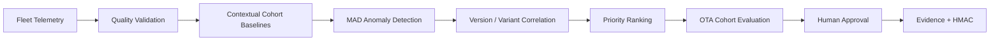

# FleetSense Automotive Intelligence

A dependency-free Python platform that converts automotive fleet telemetry into data-quality evidence, cohort baselines, explainable anomalies, software/variant hypotheses, investigation priorities and human-gated OTA feedback.

> FleetSense produces engineering evidence and hypotheses. It does not prove causality, issue maintenance orders, control vehicles, or automatically continue/pause/rollback OTA campaigns.

## Implemented

- typed signal catalogue with units, ranges, freshness and safety relevance
- bounded per-vehicle telemetry with identity, version, variant, region, mileage and ambient context
- data-quality analysis: completeness, validity, freshness gaps, flatlines and duplicate/order validation
- operating cohorts by variant, software version, region, ambient band and mileage band
- robust median/MAD anomaly detection against cohort baselines
- software-version/variant/signal concentration hypotheses
- transparent severity, fleet-exposure, recurrence and confidence prioritization
- OTA control/candidate finding-rate comparison
- recommendations: `continue-with-monitoring`, `pause-and-investigate`, or `rollback`
- mandatory human approval flag on rollout recommendations
- baseline/candidate report comparison
- canonical SHA-256 evidence and optional HMAC-SHA256 signing
- JSON and CSV ingestion contracts
- bounded loopback REST API, optional bearer authentication, CLI and dashboard
- deterministic **1,000-vehicle × 20-sample = 20,000-record** demonstration
- **44 dependency-free Python tests**

## Quick start

Requires Python 3.11 or later.

```bash
python -m compileall -q fleetsense tests
python -m unittest discover -s tests -v
python -m fleetsense.cli --vehicles 1000 --samples 20
python -m fleetsense.server
```

Open <http://127.0.0.1:8085>. Set `API_TOKEN` from a secret manager to require bearer authentication.

## API

| Method | Path | Purpose |
|---|---|---|
| GET | `/api/health` | Service health |
| GET | `/api/example` | Synthetic rollout dataset |
| POST | `/api/analyses` | Analyze fleet and optional OTA cohorts |
| GET | `/api/analyses/{id}` | Retrieve report |
| GET | `/api/analyses/{id}/evidence` | Retrieve evidence envelope |
| POST | `/api/evidence/verify` | Verify evidence integrity |
| POST | `/api/compare` | Compare two retained analyses |

Bodies are limited to **20,000,000 bytes**, datasets to **2,000,000 records**, synthetic generation to **20,000 vehicles × 10,000 samples**, and retained runs to **100**.

## Architecture



See [architecture](docs/architecture.md), [analytics semantics](docs/analytics-and-limitations.md), [OTA governance](docs/ota-governance.md), and [threat model](docs/threat-model.md).

## Interpretation

An anomaly means a vehicle record deviated from its contextual cohort baseline. A root-cause item is a concentration hypothesis, not causal proof. An OTA recommendation is advisory and always requires authorized human approval plus supporting engineering evidence.

## Honest roadmap

Parquet/Arrow, MQTT/Kafka, DuckDB/Polars, scikit-learn, change-point methods, multivariate models, causal experiments, geospatial privacy, persistent time-series storage, OTA-platform APIs, KMS signatures, OIDC, RBAC and tenant isolation are not implemented.

## Security and licensing

The service binds to loopback, emits restrictive browser headers, bounds requests and datasets, supports bearer authentication and has no vehicle or OTA write interface. Never commit VINs, client telemetry, credentials, private thresholds or signing keys. See [SECURITY.md](SECURITY.md).

This version is proprietary and source-available. Production, commercial, customer, vehicle, embedded-system or field use requires a separate written commercial license. See [LICENSE](LICENSE) or contact `nagaraj.rbhagwat@expleogroup.com` or an authorized Expleo Group representative. The initial historical MIT commit retains its prior grant.
